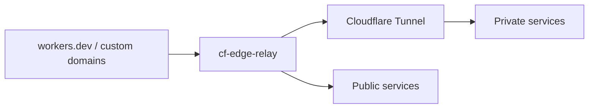

# cf-edge-relay

**English** | [简体中文](README.zh-CN.md)

Expose private HTTP services at a stable public URL without owning a domain. Use a generated `workers.dev` URL with Cloudflare Tunnel, or add custom domains and route them with the same configuration.



## Install

Requires Node.js 22+ and pnpm.

```sh
pnpm install --frozen-lockfile
pnpm exec wrangler login
cp wrangler.jsonc.example wrangler.local.jsonc
```

## Configure and deploy

Edit `wrangler.local.jsonc`:

- Set `name` to the Worker name you want in its generated URL.
- Replace the example Tunnel UUID, account subdomain, and service address.
- Set `vars.ROUTES` for inbound host/path rules and `vars.UPSTREAMS` for outbound targets.

```sh
pnpm run check
pnpm run deploy --config wrangler.local.jsonc
```

Open `https://<name>.<account-subdomain>.workers.dev`.

To keep that URL and add custom domains, use the [mixed-domain example](docs/configuration.md#generated-domain-plus-custom-domains).

## Automatic deployment

Add two repository secrets under **Settings → Secrets and variables → Actions**:

| Secret | Value |
| --- | --- |
| `WRANGLER_CONFIG` | One complete Wrangler JSONC configuration, including the deployment account ID. |
| `CLOUDFLARE_API_TOKEN` | Your Cloudflare deployment API token. |

Push source, dependency, build-configuration, or deployment-workflow changes to `main`, or run **Actions → Deploy → Run workflow**. Documentation-only changes do not trigger deployment. The configuration's `name` determines the deployed Worker.

See [configuration examples and deployment details](docs/configuration.md), including custom domains and additional generated hostnames. Keep real configurations and credentials out of Git.

## Local development

```sh
pnpm run dev --config wrangler.local.jsonc
```

[MIT License](LICENSE).
