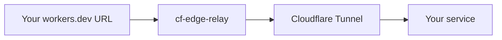

# cf-edge-relay

**English** | [简体中文](README.zh-CN.md)

Expose one private HTTP service at a stable `workers.dev` URL without owning a domain. If you already have a domain, use Cloudflare Tunnel's published application feature directly.



## Usage

Requires Node.js 22+ and pnpm.

```sh
pnpm install --frozen-lockfile
pnpm exec wrangler login
cp wrangler.jsonc.example wrangler.jsonc
```

Edit `wrangler.jsonc`:

- Set `name` to the name you want in your generated public URL.
- Set `vpc_networks[0].tunnel_id` to your Tunnel UUID. Keep the binding name `TUNNEL`.
- Set `vars.TARGET_URL` to your service address, reachable from the `cloudflared` host or container.

```sh
pnpm run check
pnpm run deploy
```

Open `https://<name>.<account-subdomain>.workers.dev`. All requests go to the same target, preserving paths, query strings, request bodies, and streaming responses.

## Automatic deployment

Add two repository secrets under **Settings → Secrets and variables → Actions**:

| Secret | Value |
| --- | --- |
| `WRANGLER_CONFIG` | Your complete Wrangler JSONC configuration. |
| `CLOUDFLARE_API_TOKEN` | Your Cloudflare deployment API token. |

Source, dependency, build-configuration, and deployment-workflow changes pushed to `main` trigger deployment. Documentation-only changes do not. You can also use **Actions → Deploy → Run workflow**.

See [deployment details](docs/configuration.md) for Tunnel requirements, token permissions, and configuration examples. Keep real configurations and credentials out of Git.

## Local development

```sh
pnpm run dev
```

[MIT License](LICENSE).
