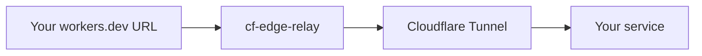

# cf-edge-relay

**English** | [简体中文](README.zh-CN.md)

Expose one private HTTP(S) or SSH service at a stable `workers.dev` URL without owning a domain. Each Worker proxies one target and selects the protocol from `TARGET_URL`.



## Quick start

You need Node.js 22+, pnpm, and a Cloudflare Tunnel that can reach your target. [Tunnel requirements](docs/configuration.md#tunnel)

```sh
pnpm install --frozen-lockfile
pnpm exec wrangler login
cp wrangler.jsonc.example wrangler.jsonc
```

Set the Worker name, Tunnel UUID, and target in `wrangler.jsonc`. Set `vars.ALLOWED_IPS` to restrict access by source address. [Configuration table](docs/configuration.md#worker-configuration)

```sh
pnpm run check
pnpm run deploy
```

## Connect

| `TARGET_URL` scheme | Client |
| --- | --- |
| `http://` or `https://` | Open `https://<name>.<account-subdomain>.workers.dev`. [Forwarding behavior](docs/configuration.md#https) |
| `ssh://` | Use OpenSSH with a `ProxyCommand` that connects to the Worker's `/ssh` endpoint. [SSH example](docs/configuration.md#ssh) |

## Deploy and troubleshoot

- [Deploy one or more Workers with GitHub Actions](docs/configuration.md#github-actions)
- [Local development and troubleshooting](docs/configuration.md#local-development-and-troubleshooting)

[MIT License](LICENSE).
