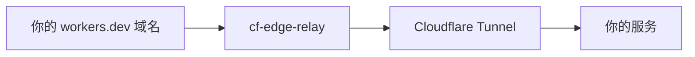

# cf-edge-relay

[English](README.md) | **简体中文**

没有自有域名，也能通过固定的 `workers.dev` 地址访问一个内网 HTTP(S) 或 SSH 服务。每个 Worker 代理一个目标，协议由 `TARGET_URL` 决定。



## 快速开始

准备 Node.js 22+、pnpm 和一条能访问目标服务的 Cloudflare Tunnel。 [Tunnel 要求](docs/configuration.zh-CN.md#tunnel)

```sh
pnpm install --frozen-lockfile
pnpm exec wrangler login
cp wrangler.jsonc.example wrangler.jsonc
```

在 `wrangler.jsonc` 填入 Worker 名称、Tunnel UUID 和目标地址。需要限制访问来源时，填写 `vars.ALLOWED_IPS`。 [配置表](docs/configuration.zh-CN.md#配置变量)

```sh
pnpm run check
pnpm run deploy
```

## 连接方式

| `TARGET_URL` 协议 | 客户端用法 |
| --- | --- |
| `http://` 或 `https://` | 访问 `https://<name>.<账号子域>.workers.dev`。 [转发行为](docs/configuration.zh-CN.md#https) |
| `ssh://` | 用 OpenSSH 的 `ProxyCommand` 连接 Worker 的 `/ssh`。 [SSH 示例](docs/configuration.zh-CN.md#ssh) |

## 部署与排查

- [通过 GitHub Actions 部署一个或多个 Worker](docs/configuration.zh-CN.md#github-actions)
- [本地开发与故障排查](docs/configuration.zh-CN.md#本地开发与排查)

[MIT 许可证](LICENSE)。
