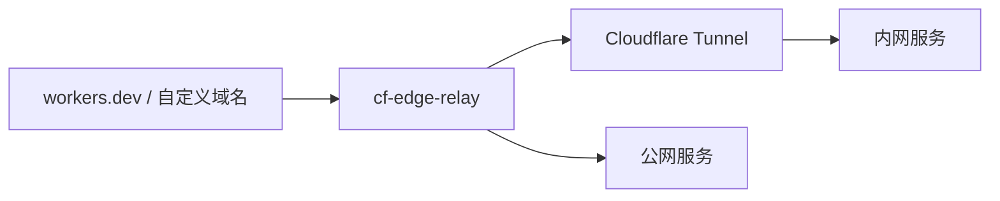

# cf-edge-relay

[English](README.md) | **简体中文**

没有自有域名，也能通过固定公网地址访问内网 HTTP 服务。使用自动生成的 `workers.dev` 域名配合 Cloudflare Tunnel，或添加自定义域名，统一通过配置设置代理规则。



## 安装

需要 Node.js 22+ 和 pnpm。

```sh
pnpm install --frozen-lockfile
pnpm exec wrangler login
cp wrangler.jsonc.example wrangler.local.jsonc
```

## 配置与部署

编辑 `wrangler.local.jsonc`：

- 用 `name` 设置自动域名中的 Worker 名称。
- 替换示例 Tunnel UUID、账号子域和服务地址。
- 用 `vars.ROUTES` 配置入站域名／路径，`vars.UPSTREAMS` 配置出口。

```sh
pnpm run check
pnpm run deploy --config wrangler.local.jsonc
```

访问 `https://<name>.<账号子域>.workers.dev`。

同时保留自动域名并添加自定义域名，参考[混合域名示例](docs/configuration.zh-CN.md#自动域名加多个自定义域名)。

## 自动部署

在仓库 **Settings → Secrets and variables → Actions** 添加两个 Secret：

| Secret | 内容 |
| --- | --- |
| `WRANGLER_CONFIG` | 一份完整的 Wrangler JSONC 配置，包含部署账号 ID。 |
| `CLOUDFLARE_API_TOKEN` | Cloudflare 部署 Token。 |

源码、依赖、构建配置或部署 workflow 的变更 push 到 `main` 时自动部署；仅修改文档不会触发。也可在 **Actions → Deploy → Run workflow** 手动执行。配置中的 `name` 决定部署哪个 Worker。

自定义域名、更多自动域名及其他细节见[配置文档](docs/configuration.zh-CN.md)。真实配置和凭据不要提交到 Git。

## 本地开发

```sh
pnpm run dev --config wrangler.local.jsonc
```

[MIT 许可证](LICENSE)。
