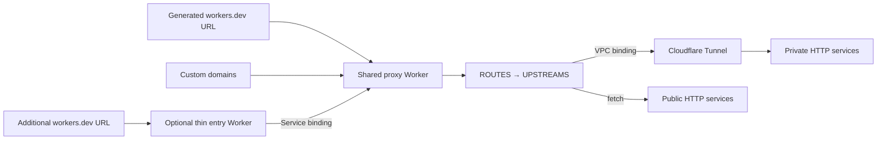

# Configuration and examples

**English** | [简体中文](configuration.zh-CN.md)

Expose private HTTP services at a stable public URL without owning a domain.

cf-edge-relay is a configurable TypeScript reverse proxy for Cloudflare Workers. Use the Worker's generated `workers.dev` address as your public entry point and Cloudflare Tunnel to reach your private service, without a public origin IP or inbound port forwarding. You can also attach custom domains and route them through the same proxy rules.



The proxy does not distinguish generated URLs from custom domains. Every request uses the original hostname and path to select a configured outbound target.

## Features

- One-to-one, many-to-one, and many-to-many routing through configuration.
- Exact hostnames, `*.example.com`, and `*` host matching.
- Path-prefix routing with path-segment boundaries and optional prefix stripping.
- Public HTTP(S) upstreams, Workers VPC bindings, and Worker service bindings.
- Multiple targets per rule, selected randomly with equal probability.
- Streaming request and response bodies, SSE, and native WebSocket upgrade passthrough.
- Configurable HTTP `Host` headers and upstream-origin redirect rewriting.

## Quick start: generated domain only

1. Install dependencies and sign in:

   ```sh
   pnpm install --frozen-lockfile
   pnpm exec wrangler login
   ```

2. Create or reuse a named Cloudflare Tunnel that can reach your private HTTP service. Workers VPC requires `cloudflared` 2025.7.0 or later and an active QUIC connection; allow outbound UDP port 7844. See the [Workers VPC Tunnel guide](https://developers.cloudflare.com/workers-vpc/configuration/tunnel/).

3. Copy the root [configuration template](../wrangler.jsonc.example):

   ```sh
   cp wrangler.jsonc.example wrangler.local.jsonc
   ```

4. In your local copy, replace the example Tunnel UUID, `YOUR_ACCOUNT_SUBDOMAIN`, and private service URL. The private address must be reachable from the `cloudflared` host or container. `PRIVATE_NET` is the binding name referenced by the outbound configuration. Direct Tunnel binding requires the **Connectivity Directory Admin** role.

5. Deploy:

   ```sh
   pnpm run check
   pnpm run deploy --config wrangler.local.jsonc
   ```

Your entry point is `https://proxy.<your-account-subdomain>.workers.dev`. It uses a stable generated hostname; no custom domain or Quick Tunnel URL is required.

The complete configuration for this case is:

```json
{
  "name": "proxy",
  "main": "src/proxy.ts",
  "compatibility_date": "2026-11-05",
  "workers_dev": true,
  "vpc_networks": [
    {
      "binding": "PRIVATE_NET",
      "tunnel_id": "00000000-0000-4000-8000-000000000001"
    }
  ],
  "vars": {
    "UPSTREAMS": {
      "app": { "url": "http://10.0.0.10:8080", "binding": "PRIVATE_NET" }
    },
    "ROUTES": [
      {
        "hosts": ["proxy.YOUR_ACCOUNT_SUBDOMAIN.workers.dev"],
        "pathPrefix": "/",
        "upstreams": ["app"]
      }
    ]
  }
}
```

## Generated domain plus custom domains

For generated and custom domains together, put this configuration in `wrangler.local.jsonc`:

```json
{
  "name": "proxy",
  "main": "src/proxy.ts",
  "compatibility_date": "2026-11-05",
  "workers_dev": true,
  "routes": [
    { "pattern": "app.example.com", "custom_domain": true },
    { "pattern": "api.example.com", "custom_domain": true }
  ],
  "vpc_networks": [
    {
      "binding": "PRIVATE_NET",
      "tunnel_id": "00000000-0000-4000-8000-000000000001"
    }
  ],
  "vars": {
    "UPSTREAMS": {
      "app": { "url": "http://10.0.0.10:8080", "binding": "PRIVATE_NET" },
      "api": { "url": "https://upstream.example.net" }
    },
    "ROUTES": [
      {
        "hosts": ["proxy.YOUR_ACCOUNT_SUBDOMAIN.workers.dev"],
        "pathPrefix": "/api",
        "stripPrefix": true,
        "upstreams": ["api"]
      },
      {
        "hosts": ["api.example.com"],
        "pathPrefix": "/",
        "upstreams": ["api"]
      },
      {
        "hosts": ["proxy.YOUR_ACCOUNT_SUBDOMAIN.workers.dev", "app.example.com"],
        "pathPrefix": "/",
        "upstreams": ["app"]
      }
    ]
  }
}
```

Then deploy:

```sh
pnpm run deploy --config wrangler.local.jsonc
```

Replace its placeholders before deploying. The custom domains must belong to an active Cloudflare zone you control. Keep `workers_dev: true` to retain the generated URL alongside custom domains.

The example applies these rules to the same proxy:

| Inbound request | Outbound |
| --- | --- |
| `proxy.<account>.workers.dev/` | Private `app` service through Tunnel |
| `proxy.<account>.workers.dev/api/items` | Public `api` upstream at `/items` |
| `app.example.com/` | The same private `app` service |
| `api.example.com/` | Public `api` upstream |

The top-level Wrangler `routes` field attaches custom domains to the Worker. `vars.ROUTES` controls request routing inside the proxy. Adding a hostname to `vars.ROUTES` alone does not create DNS records or attach that hostname to the Worker.

## Configuration

Two JSON variables define all routing:

```json
{
  "UPSTREAMS": {
    "app": { "url": "http://10.0.0.10:8080", "binding": "PRIVATE_NET" },
    "api": { "url": "https://upstream.example.net" }
  },
  "ROUTES": [
    { "hosts": ["app.example.com"], "pathPrefix": "/", "upstreams": ["app"] },
    { "hosts": ["api.example.com"], "pathPrefix": "/", "upstreams": ["api"] }
  ]
}
```

### Inbound rules: `ROUTES`

Rules are evaluated in order; the first matching rule wins. Put specific paths before catch-all paths.

| Field | Meaning |
| --- | --- |
| `hosts` | Nonempty array of exact or wildcard hostnames. `*.example.com` excludes the apex `example.com`. |
| `pathPrefix` | Required path prefix. `/api` matches `/api` and `/api/items`, but not `/apifoo`. |
| `upstreams` | Nonempty array of outbound names. Multiple entries distribute requests randomly across interchangeable backends. |
| `stripPrefix` | Remove the matched prefix before appending the path to the upstream base path. Default: `false`. |
| `rewriteLocation` | Rewrite redirects targeting the upstream origin to the inbound origin. With prefix stripping, reverse the mapped base path where applicable. Default: `true`. |

### Outbound targets: `UPSTREAMS`

| Field | Meaning |
| --- | --- |
| `url` | HTTP(S) base URL; may include a base path, but not credentials, a query, or a fragment. |
| `binding` | Optional VPC or Worker service binding name. Omit it to use public `fetch()`. |
| `hostHeader` | Optional HTTP `Host` override. Defaults to the target URL's host and port. |

Register VPC bindings in Wrangler's `vpc_networks` and Worker service bindings in `services`. All targets share the same forwarding logic. Variables accept native JSON values or JSON strings.

You can edit `ROUTES` and `UPSTREAMS` in the Cloudflare dashboard without changing proxy code. Keep your local configuration synchronized: a later Wrangler deployment uploads its local variable values.

## Additional generated hostnames

Cloudflare gives each Worker one default `<worker-name>.<account-subdomain>.workers.dev` hostname. Proxy variables cannot create additional generated hostnames for a single Worker.

To expose another generated hostname through the shared proxy:

1. Save the following configuration as `entry.local.jsonc`:

   ```json
   {
     "name": "app-entry",
     "main": "src/entry.ts",
     "compatibility_date": "2026-11-05",
     "workers_dev": true,
     "services": [
       { "binding": "PROXY", "service": "proxy" }
     ]
   }
   ```

2. Choose its Worker `name` and ensure its `PROXY` service binding points to your shared proxy Worker.
3. Add that entry hostname to an appropriate `ROUTES` rule in the proxy and deploy the updated proxy configuration.
4. Deploy the entry:

   ```sh
   pnpm run deploy --config entry.local.jsonc
   ```

The entry runs [the same small forwarding module](../src/entry.ts) and passes the original request through a service binding. It contains no application-specific routing; generated and custom domains still use one shared ruleset in [src/proxy.ts](../src/proxy.ts).

## Behavior and boundaries

- Preserve request methods, query strings, credentials, cookies, and streaming bodies. Response cookies and page content are passed through without rewriting.
- Set `X-Forwarded-Host` and `X-Forwarded-Proto` from the incoming URL. Replace client-supplied forwarding identity headers; set `X-Forwarded-For` from Cloudflare's `CF-Connecting-IP` when available.
- Follow no upstream redirects automatically. Redirects to external origins remain unchanged.
- Do not retry or replay requests automatically, including requests with bodies.
- Return `404` for unmatched routes, `500` for invalid matched configuration, and `502` for upstream exceptions. A missing binding never falls back to public fetch.
- HTTP(S) reverse proxying is the scope; this is not a general TCP/UDP tunnel. Cloudflare Workers and Workers VPC platform limits apply. Authentication remains with the upstream application or Cloudflare Access.

## Development and private configuration

```sh
pnpm run check
pnpm run dev --config wrangler.local.jsonc
```

Private VPC access during local development requires remote bindings or remote development; see [Cloudflare's VPC configuration](https://developers.cloudflare.com/workers-vpc/configuration/vpc-networks/).

Committed examples contain fictional addresses and UUIDs. Keep deployment credentials in Wrangler authentication or CI secrets, and put real account IDs, Tunnel IDs, domains, and origin addresses only in ignored `*.local.jsonc` / `*.local.toml` files. No deployment credentials are needed by the proxy at runtime.

## GitHub Actions

Add two repository secrets: `WRANGLER_CONFIG` contains one complete Wrangler JSONC file, including `account_id`; `CLOUDFLARE_API_TOKEN` contains the deployment token. Comments and trailing commas are supported. All `main` paths are relative to the repository root.

The workflow writes that configuration to an ignored temporary file and runs:

```sh
pnpm exec wrangler deploy --config wrangler.ci.local.jsonc
```

The configuration's `name` selects the Worker. Configure multiple backend ports through `UPSTREAMS` and `ROUTES` in the same file. No separate deployment script is used.

Use a token with Workers Scripts Edit and the permissions required by your bindings. Direct VPC Tunnel bindings require Connectivity Directory Admin. Custom domains additionally require their relevant account/zone permissions.

Automatic deployment runs on changes to `src/`, dependency manifests/locks, TypeScript configuration, or the deployment workflow itself on `main`. README, `docs/`, license, and example-template changes alone do not trigger it. Manual dispatch remains available. The temporary configuration is removed afterward, and sensitive configuration strings are masked in Actions logs.

## License

[MIT](../LICENSE).
