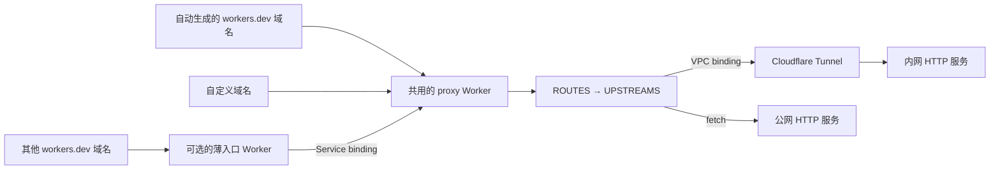

# 配置与示例

[English](configuration.md) | **简体中文**

没有自有域名，也能通过固定公网地址访问内网 HTTP 服务。

cf-edge-relay 是运行在 Cloudflare Workers 上、通过配置驱动的 TypeScript 反向代理。使用 Worker 自动生成的 `workers.dev` 地址作为公网入口，通过 Cloudflare Tunnel 连接内网服务，无需源站公网 IP 或开放入站端口。也可以接入自定义域名，所有入口共用同一套代理规则。



代理不区分自动生成的域名与自定义域名。所有请求都按原始域名和路径匹配规则，再选择配置中的出站目标。

## 功能

- 通过配置实现一对一、多对一、多对多路由。
- 支持精确域名、`*.example.com` 和 `*` 匹配。
- 按路径段边界匹配前缀，可选移除匹配的路径前缀。
- 支持公网 HTTP(S)、Workers VPC binding 和 Worker service binding 出口。
- 同一规则可以配置多个出口，以相同概率随机选择。
- 保留请求与响应的流式传输，支持 SSE 和原生 WebSocket 升级透传。
- 可配置 HTTP `Host`，并改写指向上游自身地址的重定向。

## 快速开始：仅使用自动域名

1. 安装依赖并登录：

   ```sh
   pnpm install --frozen-lockfile
   pnpm exec wrangler login
   ```

2. 创建或复用一条可以访问目标内网 HTTP 服务的具名 Cloudflare Tunnel。Workers VPC 要求 `cloudflared` 版本至少为 2025.7.0，并实际使用 QUIC 连接；需允许出站 UDP 7844。参考 [Workers VPC Tunnel 文档](https://developers.cloudflare.com/workers-vpc/configuration/tunnel/)。

3. 复制根目录的[配置模板](../wrangler.jsonc.example)：

   ```sh
   cp wrangler.jsonc.example wrangler.local.jsonc
   ```

4. 在本地副本中替换示例 Tunnel UUID、`YOUR_ACCOUNT_SUBDOMAIN` 和内网服务地址。该地址必须能从 `cloudflared` 所在主机或容器访问。`PRIVATE_NET` 是出口配置引用的 binding 名称。直接绑定 Tunnel 需要 **Connectivity Directory Admin** 角色。

5. 部署：

   ```sh
   pnpm run check
   pnpm run deploy --config wrangler.local.jsonc
   ```

公网入口为 `https://proxy.<账号子域>.workers.dev`。这个自动生成的域名保持固定，无需自定义域名或 Quick Tunnel 地址。

这种情况的完整配置如下：

```json
{
  "name": "proxy",
  "main": "src/proxy.ts",
  "compatibility_date": "2026-11-05",
  "workers_dev": true,
  "vpc_networks": [
    {
      "binding": "PRIVATE_NET",
      "tunnel_id": "00000000-0000-4000-8000-000000000001"
    }
  ],
  "vars": {
    "UPSTREAMS": {
      "app": { "url": "http://10.0.0.10:8080", "binding": "PRIVATE_NET" }
    },
    "ROUTES": [
      {
        "hosts": ["proxy.YOUR_ACCOUNT_SUBDOMAIN.workers.dev"],
        "pathPrefix": "/",
        "upstreams": ["app"]
      }
    ]
  }
}
```

## 自动域名加多个自定义域名

需要同时使用自动域名和自定义域名时，把以下配置写入 `wrangler.local.jsonc`：

```json
{
  "name": "proxy",
  "main": "src/proxy.ts",
  "compatibility_date": "2026-11-05",
  "workers_dev": true,
  "routes": [
    { "pattern": "app.example.com", "custom_domain": true },
    { "pattern": "api.example.com", "custom_domain": true }
  ],
  "vpc_networks": [
    {
      "binding": "PRIVATE_NET",
      "tunnel_id": "00000000-0000-4000-8000-000000000001"
    }
  ],
  "vars": {
    "UPSTREAMS": {
      "app": { "url": "http://10.0.0.10:8080", "binding": "PRIVATE_NET" },
      "api": { "url": "https://upstream.example.net" }
    },
    "ROUTES": [
      {
        "hosts": ["proxy.YOUR_ACCOUNT_SUBDOMAIN.workers.dev"],
        "pathPrefix": "/api",
        "stripPrefix": true,
        "upstreams": ["api"]
      },
      {
        "hosts": ["api.example.com"],
        "pathPrefix": "/",
        "upstreams": ["api"]
      },
      {
        "hosts": ["proxy.YOUR_ACCOUNT_SUBDOMAIN.workers.dev", "app.example.com"],
        "pathPrefix": "/",
        "upstreams": ["app"]
      }
    ]
  }
}
```

然后部署：

```sh
pnpm run deploy --config wrangler.local.jsonc
```

部署前先替换其中的占位配置。自定义域名必须属于你控制的、已在 Cloudflare 激活的区域。保留 `workers_dev: true`，自动域名与自定义域名就能同时使用。

示例在同一个代理中配置以下规则：

| 入站请求 | 出站目标 |
| --- | --- |
| `proxy.<账号>.workers.dev/` | 通过 Tunnel 访问内网 `app` 服务 |
| `proxy.<账号>.workers.dev/api/items` | 公网 `api` 上游的 `/items` |
| `app.example.com/` | 同一个内网 `app` 服务 |
| `api.example.com/` | 公网 `api` 上游 |

Wrangler 顶层的 `routes` 用于把自定义域名绑定到 Worker；`vars.ROUTES` 用于代理内部的请求匹配。仅在 `vars.ROUTES` 中添加域名，不会创建 DNS 记录或把域名绑定到 Worker。

## 配置

所有路由由两个 JSON 变量定义：

```json
{
  "UPSTREAMS": {
    "app": { "url": "http://10.0.0.10:8080", "binding": "PRIVATE_NET" },
    "api": { "url": "https://upstream.example.net" }
  },
  "ROUTES": [
    { "hosts": ["app.example.com"], "pathPrefix": "/", "upstreams": ["app"] },
    { "hosts": ["api.example.com"], "pathPrefix": "/", "upstreams": ["api"] }
  ]
}
```

### 入站规则：`ROUTES`

按顺序匹配，第一条命中的规则生效。具体路径规则应放在兜底规则之前。

| 字段 | 含义 |
| --- | --- |
| `hosts` | 非空域名数组，支持精确域名和通配符。`*.example.com` 不匹配根域 `example.com`。 |
| `pathPrefix` | 必填路径前缀。`/api` 匹配 `/api`、`/api/items`，不匹配 `/apifoo`。 |
| `upstreams` | 非空出口名称数组。多个出口用于在可互换的后端之间随机分流。 |
| `stripPrefix` | 拼接上游基础路径前，先移除匹配的前缀。默认 `false`。 |
| `rewriteLocation` | 把指向上游 origin 的重定向改为入站 origin。启用前缀移除时，在路径匹配的情况下反向还原基础路径映射。默认 `true`。 |

### 出站目标：`UPSTREAMS`

| 字段 | 含义 |
| --- | --- |
| `url` | HTTP(S) 基础地址，可带基础路径，不能包含用户名密码、查询参数或片段。 |
| `binding` | 可选的 VPC 或 Worker service binding 名称。不填写则使用公网 `fetch()`。 |
| `hostHeader` | 可选 HTTP `Host` 覆盖值。默认使用目标 URL 的主机名和端口。 |

VPC binding 在 Wrangler 的 `vpc_networks` 中声明，Worker service binding 在 `services` 中声明。不同出口共用同一份转发逻辑。变量既可以是原生 JSON，也可以是 JSON 字符串。

可以在 Cloudflare 控制台修改 `ROUTES`、`UPSTREAMS`，无需修改代理代码。本地配置也要同步更新，因为下次 Wrangler 部署会上传本地变量值。

## 更多自动生成的域名

Cloudflare 为每个 Worker 分配一个默认的 `<Worker 名称>.<账号子域>.workers.dev` 域名。代理变量不能为同一个 Worker 创建更多自动域名。

需要把另一个自动域名接入共用代理时：

1. 把以下配置保存为 `entry.local.jsonc`：

   ```json
   {
     "name": "app-entry",
     "main": "src/entry.ts",
     "compatibility_date": "2026-11-05",
     "workers_dev": true,
     "services": [
       { "binding": "PROXY", "service": "proxy" }
     ]
   }
   ```

2. 配置入口 Worker 的 `name`，并确认 `PROXY` service binding 指向共用代理 Worker。
3. 把入口域名加入代理中对应的 `ROUTES` 规则，并部署更新后的代理配置。
4. 部署入口：

   ```sh
   pnpm run deploy --config entry.local.jsonc
   ```

入口运行[同一个简单转发模块](../src/entry.ts)，通过 service binding 传递原始请求，不包含专属业务路由。所有自动域名和自定义域名仍统一使用 [src/proxy.ts](../src/proxy.ts) 中的一套规则。

## 行为与边界

- 保留请求方法、查询参数、认证信息、Cookie 和流式请求体。响应 Cookie 与页面内容原样透传，不自动改写。
- 从入站 URL 设置 `X-Forwarded-Host`、`X-Forwarded-Proto`。替换客户端提供的转发身份头；存在 Cloudflare `CF-Connecting-IP` 时，用其设置 `X-Forwarded-For`。
- 不自动跟随上游重定向，指向外部 origin 的重定向保持原样。
- 不自动重试或重放请求，包括带请求体的请求。
- 未匹配返回 `404`，匹配配置无效返回 `500`，上游异常返回 `502`。binding 缺失时不会退回公网出口。
- 项目提供 HTTP(S) 反向代理，不是通用 TCP/UDP 隧道；受 Cloudflare Workers 和 Workers VPC 平台限制。身份认证由上游应用或 Cloudflare Access 承担。

## 开发与私有配置

```sh
pnpm run check
pnpm run dev --config wrangler.local.jsonc
```

本地开发访问私网 VPC 时，需要使用远程 binding 或远程开发模式；参考 [Cloudflare VPC 配置文档](https://developers.cloudflare.com/workers-vpc/configuration/vpc-networks/)。

提交的示例只包含虚构地址和 UUID。部署凭据使用 Wrangler 登录或 CI secrets 提供；真实账号 ID、Tunnel ID、域名和源站地址只填写在已忽略的 `*.local.jsonc` / `*.local.toml` 文件中。代理运行时不需要部署凭据。

## GitHub Actions：单个或多个部署

workflow 只读取两个仓库 Secret：`WRANGLER_CONFIG` 和 `CLOUDFLARE_API_TOKEN`。配置 Secret 接受本地 Wrangler 文件的完整 JSONC 对象，支持注释和尾随逗号。配置中填写 `account_id`，以便无交互选择部署账号。所有 `main` 路径相对于仓库根目录。

部署多个 Worker 或不同后端端口时，在同一个 `WRANGLER_CONFIG` Secret 中保存完整配置组成的数组。例如：

```json
[
  {
    "name": "app-a",
    "main": "src/proxy.ts",
    "compatibility_date": "2026-11-05",
    "workers_dev": true,
    "vpc_networks": [
      {
        "binding": "PRIVATE_NET",
        "tunnel_id": "00000000-0000-4000-8000-000000000001"
      }
    ],
    "vars": {
      "UPSTREAMS": {
        "app": {
          "url": "http://10.0.0.10:8080",
          "binding": "PRIVATE_NET"
        }
      },
      "ROUTES": [
        {
          "hosts": [
            "app-a.YOUR_ACCOUNT_SUBDOMAIN.workers.dev"
          ],
          "pathPrefix": "/",
          "upstreams": [
            "app"
          ]
        }
      ]
    },
    "account_id": "YOUR_ACCOUNT_ID"
  },
  {
    "name": "app-b",
    "main": "src/proxy.ts",
    "compatibility_date": "2026-11-05",
    "workers_dev": true,
    "vpc_networks": [
      {
        "binding": "PRIVATE_NET",
        "tunnel_id": "00000000-0000-4000-8000-000000000001"
      }
    ],
    "vars": {
      "UPSTREAMS": {
        "app": {
          "url": "http://10.0.0.10:9090",
          "binding": "PRIVATE_NET"
        }
      },
      "ROUTES": [
        {
          "hosts": [
            "app-b.YOUR_ACCOUNT_SUBDOMAIN.workers.dev"
          ],
          "pathPrefix": "/",
          "upstreams": [
            "app"
          ]
        }
      ]
    },
    "account_id": "YOUR_ACCOUNT_ID"
  }
]
```

每份配置用同一套 TypeScript 代理源码创建或更新一个 Worker，`name` 必须各不相同。按数组顺序依次部署；使用 service binding 薄入口时，先部署共用代理，再部署入口。失败后停止后续部署。

Token 需具有 Workers Scripts Edit 以及对应 binding 所需权限；直接绑定 VPC Tunnel 需要 Connectivity Directory Admin。使用自定义域名时还需相应账号／区域权限。Token 到期后更新对应 Secret。

Push 到 `main` 或手动运行时，workflow 安装锁定的 pnpm 依赖、检查 TypeScript，再部署配置。私有配置只写入临时的、被 Git 忽略的本地文件，完成后删除；Actions 日志会屏蔽配置中的字符串值。

## 许可证

[MIT](../LICENSE)。
